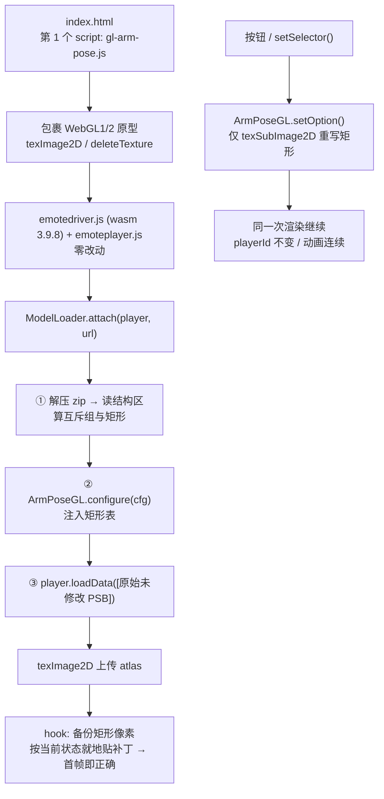

# E-mote 互斥部件 GPU 补丁 · 技术路线

> **适用**：`steins_gate/` 页面，E-mote WebGL SDK **3.9.8**
> **问题**：模型按 4.0 的「动态插入 / 删除追加部件」制作，3.9.8 不认识该机制，把本该互斥的几套部件同时画出来
> **状态**：已落地并验证 —— 一份原始模型 + WebGL 纹理层补丁，运行时切换任意互斥选项
> **配套**：《手臂姿势切换实现说明.md》讲怎么用，本文讲为什么这样做、判据是什么、怎么验证

> **In English** — A browser player running on the E-mote WebGL SDK 3.9.8. The models are authored for 4.0 and
> use `customPartsList` plus `emote.extension.command.insert` / `delete` to add mutually exclusive parts; 3.9.8
> ignores those commands, so every variant is drawn at once (four sleeves instead of two). The SDK exposes no
> part-visibility API — of the 74 exported `EmotePlayer_*` functions, only `SetPartsScale` mentions parts at all — so the fix works
> one layer lower: while an atlas is uploaded through `texImage2D`, the rectangles owned by unselected options
> are backed up and erased, and switching an option rewrites them via `texSubImage2D` (44–85 ms, no player
> rebuild, animation stays continuous). Selectors, options and rectangles are all derived from the PSB v4
> structure at load time (~10 ms), so the only input is the model zip. Sections: root cause, implementation and
> grouping criteria, verification, and the false starts that were later disproved.

---

## 0. 结论速览

| 维度 | 结果 |
|---|---|
| 根因 | 模型用 4.0 的 `customPartsList` + `emote.extension.command.insert/delete` 动态插入互斥部件；3.9.8 wasm 不解析这些字段，两套都当普通节点渲染 |
| 为什么 SDK 层无解 | wasm 74 个 `EmotePlayer_*` 导出（连同 `EmoteDevice_*` 共 83 个）中唯一带 `Parts` 的是 `SetPartsScale`，**没有部件显隐 / 透明度 API**；`iemote.h` 是纯虚声明，无实现可重编译 |
| 方案 | 在 `texImage2D` 上传 atlas 时按矩形备份像素，用 `texSubImage2D` 写 0 / 还原，实现在 GPU 纹理层的互斥 |
| 收益 | 不重建播放器、`playerId` 不变、动画 / 物理 / 时间线连续；切换 **44–85 ms**，无 222 MB 副本 |
| 输入 | **只有模型 zip**。选择器 / 选项 / 矩形全部在页面里从 PSB 结构区算出来（约 10 ms），无构建步骤 |
| 验收 | 视觉数部件：手臂模型两种姿势各 2 袖，桐生 5 个拇指形态互异，椎名两个状态各 2 条完整手臂 |

---

## 1. 问题与根因

### 1.1 三种表现形态

同一套机制在不同模型上表现为不同症状，这是最早走弯路的原因 —— 一开始把它当成三个独立 bug：

| 模型 | 现象 | 实际是 |
|---|---|---|
| 牧瀬紅莉栖 | 胸前一对抱臂袖子，身体两侧又有一对下垂长袖，共 **4 个袖子** | A / B 两套追加手臂同时渲染 |
| 桐生萌郁 | 多个拇指 / 手背叠在一起 | `yubi_type` 5 个选项同时渲染 |
| 椎名まゆり | 同一侧出现两条前臂；某些状态剩「断臂 + 孤立手掌」 | 互斥部件 + **运动层**两层叠加 |

### 1.2 根因链

```
模型编辑器侧（.psb.m.json）
  metadata.customSelectorList
    └─ arm_type（父选择器 type=6，0=A / 1=B）
         ├─ arm_type_a（type=7，owned/weak，0=显示 100=隐藏）
         └─ arm_type_b（同上）
  metadata.customPartsList
    ├─ 追加_eff_A白衣 / 追加_腕A…   （A 组，26 icons → 13 个贴图矩形）
    └─ 追加_eff_B白衣 / 追加_腕B…   （B 组，34 icons → 18 个贴图矩形）
  extensions: emote.extension.command.insert / delete / move
        ↓ 编译为运行时 pure.psb
运行时文件仍完整保留 metadata.customSelectorList / customPartsList /
variableMetaInfoList；早先在字节里搜不到键名只是因为 PSB 键名被编码
        ↓ 3.9.8 wasm 加载
不认识 extension 指令 → 不执行 insert/delete → A、B 两套部件都作为普通节点渲染
        ⇒ 4 个袖子
```

> 注：曾经认为「运行时模型已剥离编辑器元数据」，因此必须依赖 `.psb.m.json` 工程文件。后来用 `PsbDecompile` 反编译 `pure.psb` 才发现元数据完整保留 —— 这条更正让「只丢一个 zip 就能用」成为可能（见 §4.4）。

支撑证据：

- `variableList` 里查不到 `arm_type_a/b`，是因为 `touchVariableList()` 跳过无帧别名变量（`frameCount == 0`），**不代表变量失效**。相反，`setVariable` 确实能写、能回读、也会改变画面 —— 只是**改姿势 / 局部叠加**，不会隐藏整套手臂。
- 5×5 `arm_type_a/b` 网格 + 155 个候选变量扫描：没有任何组合能移除多余的那只手（肤色像素 `R<60` 的用例数为 **0**）。
- 贴图里 A / B 两套袖子与手是**独立 sprite**，分区存放且互不共用 —— 这是「可以整套擦除」的物理基础。

### 1.3 为什么不能靠改 SDK 解决

| 路径 | 判定 |
|---|---|
| 换 4.0 driver | 手上没有；且 4.0 能否直读现有 `pure.psb` 未验证（可能要重新导出） |
| 用 `iemote.h` 重编译 | 文件头即 `AUTO GENERATED ... DON'T EDIT`，全是 `virtual ... = 0` 纯虚声明；目录内无 `.cpp` / `.a` / `.lib`；头里的 `Show/Hide` 在 wasm 导出里也不存在。改头只会让 JS 包装层 ABI 对不上 |
| 改 wasm 二进制 | 缺的是**整套 extension 引擎**，不是某个开关；93 个 import 全被 minify 成 `env.a … env.Ka`，无「部件」概念可锚定 |
| 换 asm.js 调试构建 | 可读，能定位 draw 循环，但仍无部件概念、性能更差。适合作分析工具，不适合作交付 |
| 跳过 draw call | 探针实测每帧 171 个 draw，UV 是贴图像素坐标，但约 33 个 draw 的 UV bbox 横跨整张贴图（批量绘制），A/B 归属无法干净判定 |

**结论**：SDK 层没有捷径，落点必须在数据层或渲染层。

### 1.4 验收标准

**必须落在视觉上**：「只剩 2 个袖子」，而不是「变量值正确」「像素差为 0」「兼容层生效」。

这个区别是整条路线最关键的一次纠偏 —— 早期曾把 `arm_type=1 / arm_type_a=100 / arm_type_b=0` 判为已修复，但那只是**换了个姿势**，两套袖子仍同时在画面里。

后续所有验证按此顺序取证：

1. 全身截图**数部件**（视觉）
2. 客观指标：截图 SHA256、肤色 / 色彩像素统计
3. 运行时状态：`playerId`、`applyCount`、GL 错误、console error
4. 最后才看变量值

---

## 2. 当前实现

### 2.1 数据流



**加载时序**（顺序不可颠倒）：

```text
index.html
  gl-arm-pose.js        ← 必须是第一个，早于任何 WebGL 上下文创建
  emote-config.js
  ../driver/emotedriver.js (wasm)
  ../driver/emoteplayer.js
  ../libs/fflate.js
  model-loader.js → lipsync / actions / validator → main.js
  body onload: EmoteDriver_Launch(start)

start()
  ① EmotePlayer.createRenderCanvas(BUF_W, BUF_H)
  ② new EmotePlayer(canvas)
  ③ ModelLoader.attach(...)   // 先算配置并 configure，再 loadData 原始 PSB
```

### 2.2 模块职责

| 文件 | 规模 | 职责 |
|---|---|---|
| `steins_gate/gl-arm-pose.js` | 652 行 / 27.9 KB | 全部 GPU 侧逻辑：hook `texImage2D` / `deleteTexture`、纹理记录、像素备份、`selector → option` 状态机、矩形级 keep/erase。配置驱动、模型无关，暴露 `window.ArmPoseGL` |
| `steins_gate/model-loader.js` | 1478 行 / 68.9 KB | 三段内联：① PSB v4 结构解析 ② 归组规则（算配置）③ 加载编排；另含 `SelectorAPI` 兼容层 |
| `steins_gate/main.js` | 1177 行 | `MODEL_PSB`、默认选项、侧边「差分控制」面板、全局 API |
| `driver/` wasm + `emoteplayer.js` | — | **一行未改** |

### 2.3 从字节里读结构区

`fetchPsbData()` 本来就把 zip 解压成一个约 200 MB 的 `Uint8Array` 交给 SDK，语义信息就在这份字节里，无需任何额外下载或工具。

PSB v4 布局：56 字节头 → 名称 Trie → 条目树 → 字符串表 → 资源偏移表 → 之后才是贴图数据。结构区不到 1 MB：

| 模型 | `offsetChunkData` | 含义 |
|---|---:|---|
| 白衣（222,447,120 B） | 935,440 | 结构区 0.9 MB，其余 221.5 MB 是贴图 |
| 夹克（214,999,056 B） | 958,480 | 同上 |

| 部分 | 解码规则 |
|---|---|
| Header | `Signature(4) / Version(u16) / Encrypt(u16)` + 11 个 u32 偏移 + checksum，v4 共 56 B |
| Names | `Charset / NamesData / NameIndexes` 三个 `PsbArray`，按 `chr - Charset[NamesData[chr]]` 沿 Trie 回溯出 UTF-8 键名 |
| `PsbArray` | `type(0x0D..0x14)` → count 字节数 N → 紧凑小端 count → `0x0C + entryLength` marker → count 个定宽元素 |
| Entries | 从 `offsetEntries` 递归解码：`0x20=List`、`0x21=Objects`、`0x15..0x18=字符串索引`、`0x19..0x1C=资源索引`；值偏移相对两个数组读完后的位置 |
| Strings | 位置 = `offsetStringsData + StringOffsets[idx]`，读到 NUL，UTF-8 解码 |
| 资源 | 只保留索引占位，**不读 `offsetChunkData` 之后的贴图数据** |

格式说明参考 [FreeMote](https://github.com/UlyssesWu/FreeMote)（**CC BY-NC-SA 4.0**）的 `PsbHeader.cs` / `Psb.cs` / `PsbValues.cs` 源码；模型打包与早期校验另使用 FreeMoteToolkit 的命令行工具（`PsBuild` / `PsbDecompile`），属工具调用。**本项目不包含 FreeMote 的任何代码或二进制。**

**耗时**：浏览器内 parse 6–10 ms + 归组 3 ms，首次 12.7 ms。对照 zip 下载 547 ms、解压 806 ms、页面 READY 约 2.0 s。**约 0.01 秒，缓存没有收益** —— 这也是后来删掉预生成配置与 localStorage 的原因。

### 2.4 归组判据：哪些矩形属于哪个选项

四条规则，全部来自 PSB 结构，不写死模型名 / 变量名 / 坐标。

**① 认出「互斥追加部件组」**（`findSelectors()`）

一个 `customSelectorList` 同时满足三条才算：

- `optionList ≥ 2` 个非空选项；
- 每个 `option.label` 都在 `customPartsList[].extensions[].variable` 里出现过；
- 至少一个选项能映射到 `追加パーツプレーン` 的 icon。

其余 `head_type / body_type / eye_type / eyebrow_type / mouth_type / face_tears` 的锚点部件数 = 0、icon = 0，自动排除。这解释了早期 fallback 挑中 `head_type` 擦掉头发导致破图的原因。

**② 2 选项组：沿挂载树扩展**

`customPartsList` 里 `父.customMountBaseIndex == 子.mountIndex` 构成挂载树。互斥变量只挂在根部件上，袖子 / 手 / 衣襟等配套子部件没有变量，**必须沿树向下扩展整棵子树**才能擦干净。

只取「顶层根且名称含 `arm` / `腕`」的那棵树 —— 另一棵躯干 / 大衣树含整片衣服的大矩形，误擦会破图。

**③ 多选项组：逐部件可见性传播**

>2 选项（如桐生 5 个拇指）时，整棵树不能归给某个选项，改为逐部件判定：带选项变量的部件只在命中该选项时可见；不带变量的部件沿父链（`parentOf`）继承可见性。

**④ 运动层：配对互斥**（`slimMotionArms()`）

PSB 的 `object` 树里还有一层以选项变量名为标签的摇动层（`■追加パーツベル揺れプレーン` 等），**不在 `customPartsList` 里**。椎名まゆり的 `fade_arm_a` 有 14 个 icon、`fade_arm_c` 有 30 个，部件表只收录 6 / 12 个手掌图块，剩下的 8 / 18 个是摇动层贴图。

祖先标签链给出了干净的区分：**手臂图块**挂在 `<选项变量> > 追加パーツ` 的**直接节点**上，且是细长竖条（高 ≥ 200 且高 ≥ 1.3 × 宽）；衣服大图块虽然也竖长，但位于 `EMBED / 胴体 / ジェリー揺れ` 分支，天然被排除。

启用约束：某个互斥组里**每个选项都至少命中 2 块（左右成对）、总数 ≥ 4、且无跨选项重叠**才启用。桐生的 5 个拇指只有 2 个各命中 1 块，因此排除；6 个模型中仅椎名命中。

命中的矩形**并入该选项自己的组**（不是恒擦），于是选中谁就显示谁的整套手臂。

**归组结果**

| 模型 | 选择器 | 选项数 | 每组矩形数 | 说明 |
|---|---|---:|---|---|
| 牧瀬紅莉栖（白衣） | `arm_type` | 2 | 13 / 18 | atlas 高度 2504 / 3616 / 3656 / 3744 |
| 牧瀬紅莉栖（夹克） | `arm_type` | 2 | 22 / 16 | atlas 高度 2808 / 2920 / 3320 / 4016 |
| 桐生萌郁 | `yubi_type` | 5 | 各 1 | 5 块矩形在 `tex#000` 内互不相交 |
| 椎名まゆり | `hat_type` + `arm_type` | 2 + 2 | 帽子 18 / 2；手臂 8 / 16 | 唯一命中运动层配对 |
| 漆原るかac_巫女 / フェイリスac_イベント衣装 | 各自 1 组 | 2 | 9 / 14、14 / 10 | 运动层判据命中但被第 4 条排除（其运动层是网点 / 阴影大图，擦掉只丢质感） |

跨选择器共用矩形 = 0（全部实测），因此「矩形级保留 / 擦除」不会互相干扰；即便如此，GPU 层仍按「任一拥有者选中即保留」处理共享情况。

### 2.5 GPU 纹理补丁

| 要点 | 做法 |
|---|---|
| 捕获条件 | `texImage2D` 9 参数形式；`target=TEXTURE_2D`、`level=0`、宽 4096、高 ∈ 该模型 atlas 高度集、format=`RGBA(0x1908)`、type=`UNSIGNED_BYTE(0x1401)`、`byteLength = w*h*4` |
| 像素备份 | 从上传数据按矩形抠出，约 **31 MB**；每个矩形只备份一次 |
| 行序 | 上传 `flipY=false` 时 `yoffset = top`；`flipY=true` 时 `yoffset = H-top-h` 且逐行倒取。写入时强制 `UNPACK_FLIP_Y_WEBGL=false` |
| 预乘 alpha | `UNPACK_PREMULTIPLY_ALPHA_WEBGL` 设为与上传时一致，使写回数据经历与上传相同的变换 |
| GL 状态 | 保存 / 恢复 `ACTIVE_TEXTURE`、`TEXTURE_BINDING_2D`、两个 pixelStore 开关，`try/finally` 保证还原 |
| 幂等 | 每条记录带 `appliedSig`（选择器状态的签名）；`setPose()` 跳过已贴过的记录 |
| 重复上传 | 重新 `loadData` 会再上传全部 atlas（`uploads` 4→8）。hook 覆盖旧记录并按当前状态自动重贴 |
| 上下文丢失 | 清掉失效记录、保留目标状态；`webglcontextrestored` 后随重新上传自动重建 |
| hook 安装 | own-property 判定 + `__armPoseWrapped` 标记，避免 `WebGL2RenderingContext.prototype` 继承 WebGL1 原型时漏装或双层包裹 |
| 同高 atlas 识别 | 先用 `activeKeySet` 过滤出「确实带互斥组矩形」的贴图；多张候选时用 `contentScore()` 在该贴图 icon 矩形内 3×3 采样统计 `alpha≠0` 命中率，取最高者；打平时按 `order-tie` 分给尚无记录的候选。`uploads[].matchedBy` 可直接诊断 |

**为什么不是「跳过 draw call」**：见 §1.3 末行。纹理层补丁绕开了归属判定 —— 不管哪次 draw 采样到该区域，读到的都是全透明。

### 2.6 控制面

**`SelectorAPI`**（内联在 `model-loader.js`）：`attach()` 时只在 player **实例**上包一层，driver 一行不改，可随时 `uninstall()`。

| 方法 | 语义 |
|---|---|
| `setSelector(label, option, ms?, easing?)` | 设置选项，返回生效名；`option` 接受完整名 / 唯一后缀简写（`'c'`）/ 0-based 索引 |
| `getSelector` / `getSelectorIndex` / `getSelectors` | 当前选项名 / 索引 / 全部组 |
| `countSelectors` / `getSelectorLabelAt` / `getSelectorOptions` | 对齐 `iemote.h` 的枚举风格 |
| `setVariable(label, value, ms, easing)` | **代理**：`label` 是选择器且 `value` 是字符串或合法索引 → 走 `setSelector`；其它原样透传 |
| `getVariable(label)` | **代理**：选择器返回选项索引；其它透传 |

代理的边界很关键：动作配置里的 `fade_*` 变量全部透传（当前配置里不含选择器名）；`0..100` 这类原生数值、小数、越界数字一律透传并 warn，避免把「变量值 100」误判成「第 100 个选项」。

**时间线桥**：3.9.8 只把选择器索引当普通 float 存下，不会展开成 `fade_yubi_*` 的互斥显隐，所以模型自带的「携帯入力」时间线原生播放时手指不动。桥用 `requestAnimationFrame` 逐帧读**原生** `getVariable`，值一变就同步到 GPU 状态；首帧只记基线不动作，外部改动时重对齐并抑制 2 帧，`setSelector` 回写索引变量并抑制 3 帧。只有确实在写选择器变量的时间线受影响。

**侧边面板**（默认收起，右侧 340 px）：① 互斥部件（GPU 补丁，按选择器分行） ② 原生差分（写模型的 `onValue`/`offValue`） ③ 变量微调（3.9.8 认识的 32 个变量） ④ 时间线（主时间线 + 差分槽 1/2） ⑤ 部件清单（只读，带搜索）。

### 2.7 换一个模型

把新的 `pure.zip` 放进 `data/`，改 `main.js` 的 `MODEL_PSB` 指向它。**就这一步。**

选择器名、选项数、矩形、atlas 高度、按钮文字全部自动适配。模型若没有任何互斥追加部件组（如 `フェイリスac_制服`），`configure()` 不调用、`disable()` 生效，页面正常显示、不出现切换按钮，`setSelector()` 给出明确错误而非静默失败。

---

## 3. 验证方法

### 3.1 判据顺序

见 §1.4。补充两条实操经验：

- **3.9.8 的 `SetVariable` 要等一帧才反映到 `GetVariable`**，读值前等 160 ms。
- **截图哈希会因 SDK 自带眨眼动画抖动**（差异框在脸部）。判据用「同状态截图逐字节一致」为主，偶发抖动需单独重跑确认，不能直接判失败。

### 3.2 关键实测

| 项目 | 结果 |
|---|---|
| 启动 | `READY` 约 1.7–2.1 s；首帧 4 张 atlas 全部贴好补丁，`applyCount=0`（hook 自动完成，无闪帧） |
| 切换 | 按钮 / API 单次 **44–85 ms**（早期实现 79–83 ms，优化后 44–54 ms） |
| `playerId` | 全程 `227737816` 不变 → 没有 `loadData` 重建 |
| 重复上传 | 主动再 `loadData`：`uploads` 4→8，全部记录自动重贴 |
| 网络 | 模型请求**仅 1 个** zip，无任何配置 / 结构 JSON |
| 错误 | `PAGE ERRORS=[]`、`glErrors=[]`，`node --check` 全部 JS 通过 |
| 色彩 | `blue=0`（无 BGRA 通道交换）；橙棕像素与基线同量级 |
| 内存 | 矩形备份约 31 MB（A+B 全部矩形），随模型规模线性增长 |

### 3.3 各模型结论

回归集为 6 个模型，覆盖三类结构：2 选项手臂、>2 选项拇指、含运动层的多组模型。`data/` 下现有 16 个角色目录、170 个 zip，未逐一回归 —— 换模型后按 §3.1 自行确认即可。

| 场景 | 结论 |
|---|---|
| 白衣两个选项 | 各 2 袖，白大褂无破洞，橙棕头发与红领带正常 |
| フェイリスac_イベント衣装 | 7 张 atlas 中有 3 组同高；互斥矩形全在 `tex#000`（高度唯一），其余同高贴图被 `activeKeySet` 正确放过 |
| 桐生萌郁 5 选项 | 每个选项只剩 1 个且互不相同的拇指 / 手背形态，差异框只落在手部 |
| 椎名まゆり 放下 | 2 条下垂手臂 + 2 只手掌，无胸前断臂 |
| 椎名まゆり 抬起 | 2 条抓衣领手臂 + 2 只手掌，无多余下垂长臂 |
| 漆原るかac_巫女 / 单套手臂模型 | 运动层判据不命中或模型无互斥组时不启用补丁，画面与原生 SDK 一致 |

### 3.4 复现方式

起一个静态服务指向仓库根目录，打开 `steins_gate/index.html`（需自备 `driver/` 与 `data/`，见 README）。控制台：

```js
ArmPoseGL.info();                 // supported / configured / disabled / uploads / records / applyCount / errors
ModelLoader.getPoseConfigInfo();  // 配置来源与解析耗时
getPoseList();                    // [{name, label}]
```

`info()` 里 `records` 为空而 `supported=true`，说明 hook 装好了但当前页面没有上传符合捕获条件的 atlas —— 先查模型是否真的解压成功、`configured` 是否为 `true`。

---

## 4. 演进史

这一章记录**被推翻的判断**。它比结论更有用：结论只有一套，弯路有五条，而弯路的成因都是同一种 —— 用间接指标（变量值、像素差、局部截图）替代直接视觉事实。

### 4.1 五个阶段

| 阶段 | 假设 / 做法 | 结果 | 判定 |
|---|---|---|---|
| **0 变量层** | 认为 `arm_type_a/b` 未生效，尝试组合变量、父变量、差分时间线、隐藏变量扫描 | 只能换姿势；父变量与差分时间线像素差为 0 | ❌ 变量层无开关 |
| **1 SDK 兼容层** | 在 `emoteplayer.js` 加 `selectorBridges`，每帧把 `arm_type` 派生为 `a/b` 互斥值 | 变量值正确，时间线也能切换，但 **4 个袖子仍在** | ❌ 验收标准错了，已整体回退 |
| **2 资源级静态修复** | 按 icon 矩形把 A 组 sprite 的 RGBA 清零，直接写回 `pure.psb` 贴图偏移 | **真正只剩 2 个袖子**，颜色正常 | ✅ 有效，但姿势烘焙进资源，运行时不可切换 |
| **3 单模型 + 字节补丁热重载** | 缓存 222 MB 原始字节，切换时复制一份打补丁，再调 `loadData()` | 可切换、两态各 2 袖 | ⚠️ 每次复制 222 MB、约 1.8 s、`playerId` 变化、动画重置 |
| **4 WebGL 纹理层补丁** | hook `texImage2D` 保存矩形像素，切换时仅 `texSubImage2D` | **44–85 ms、`playerId` 不变、动画连续、无副本** | ✅ 当前方案 |

### 4.2 被推翻的五个判断

| 当时的判断 | 为什么错 | 怎么被推翻 |
|---|---|---|
| 「`arm_type_a/b` 变量没生效，找到正确组合就能修」 | 变量能写、能生效，但它只改**姿势与形变**，从不控制追加部件的显隐 | 5×5 网格 + 155 变量扫描，能移除多余手的组合为 0 |
| 「兼容层让变量值正确 = 修好了」 | 验收标准选了间接指标。变量对了，4 个袖子还在 | 全身截图数袖子 |
| 「A 手掌是 4.0 insert 部件，3.9.8 根本不绘制，需要 4.0 SDK 或 draw-call hook」 | A 手掌**一直在画**，只是落在画面更下方、被当时的裁剪窗口切掉了；而写 `fade_arm_*` 只改形变，不能把前臂移回手掌旁边，于是误判成「sprite 未绘制」 | 把 `player.scale` 调到 0.24 拍全构图，两只手掌就出现了 |
| 「纯手臂层任何状态都擦掉就行」 | C 状态干净了，A 状态变成「断臂 + 两只孤立手掌」 | 用户回传 A 状态截图；改为配对互斥后两态各自完整 |
| 「运动层整层擦掉即可」 | `fade_arm_c` 不只挂在 `追加_腕RC/LC`，还挂着 `追加_胸`、`追加_スカート`、`追加_腰リボン胸接続`；它的运动层大图是**衣服本身** | 一次擦掉 18 个 C 层图块，身体整片消失。改为只挑「与纯手臂层不同 atlas 且竖长」的 2 块 |

### 4.3 两个字节级发现

这两条不是弯路，是让方案成立的前提。

**① 贴图是未压缩 RGBA8，`PsBuild replace` 会把通道改成 BGRA。** 阶段 2 用 `PsBuild replace` 写贴图后，橙棕头发与红领带变蓝 —— 实测输出 BGRA 匹配 `3200/3200`，RGBA 仅 `1706/3200`。最终改为直接把 RGBA 字节写回原文件对应偏移，头部与索引区一个字节不动。

**② 4 张 atlas 就是原始 RGBA8 经 `texImage2D` 直传**，尺寸与字节数和 PSB 贴图区完全吻合，`UNPACK_FLIP_Y_WEBGL=false`、`UNPACK_PREMULTIPLY_ALPHA_WEBGL=false`。这直接决定了阶段 4 的落点：既然上传的是同一份像素，就可以在上传时打补丁，而不必去猜 draw call。

### 4.4 三次减法

功能做对之后，代码量反而被砍了三轮 —— 每次都是把「为了通用而引入的中间层」去掉：

| 轮次 | 去掉的东西 | 理由 |
|---|---|---|
| ① 配置驱动 | 硬编码的 4 个 atlas 高度 + 31 个矩形 | 换模型即静默失效（`uploads:0`）。改为从结构算，一份配置覆盖全部模型 |
| ② 干掉构建 | Python 生成器 → 页面内 JS 现场算 → 再进一步删掉预生成 JSON 与 localStorage 缓存 | 解析 + 归组共约 10 ms，缓存收益为零 |
| ③ 单文件 | `psb-reader.js` + `arm-pose-config.js` + 目录 | 生产调用只有两行。内联后参与手臂修复的业务文件从 3 个降为 2 个，且 Node 回归脚本与页面共用同一份代码，不会漂移 |

---

## 5. 已知限制

- 仍是「选项二选一 / 多选一」，不能与其他动作平滑混合；模型本身没有中间态。
- 依赖「未压缩 RGBA8 经 `texImage2D` 直传」这个前提。换模型、换会压缩纹理的 SDK、或改用 WebGPU，都需要重新确认捕获条件与矩形表。
- 解析器针对**未加密的 PSB v4 `pure.psb`**。若换用加密 / 压缩壳（MDF、PSZ）、PSB v3 或其他平台导出，需扩展头部与壳处理。
- 约 31 MB 矩形备份常驻内存；`texSubImage2D` 写入需短暂切换纹理绑定与 pixelStore 状态。
- 部件清单只读。3.9.8 没有部件显隐接口，要做到「逐部件强制显隐」需为每个 `追加パーツプレーン` 维护隐藏集合，共享图块容易误擦 —— 未做。

**可选方向（均未实施）**

| 方向 | 说明 | 风险 |
|---|---|---|
| 取得 4.0 SDK | 最正解，但需先验证 4.0 能否读现有 `pure.psb` | 低，依赖厂商授权 |
| hook draw call | 若能得到逐部件 draw 粒度，可做到不写纹理、按帧剔除 | 中高；批量绘制使归属模糊 |
| 改写 PSB 结构 | 把追加部件迁到 3.9.8 认识的 `selectorControl` / opacity 帧绑定 | 高；能否这样改写未验证 |
